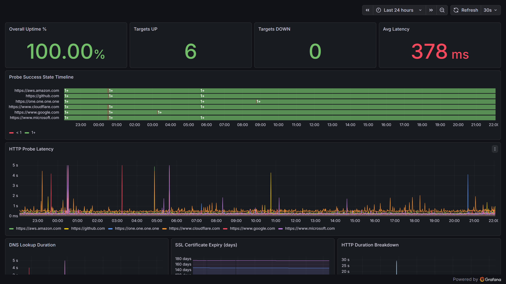
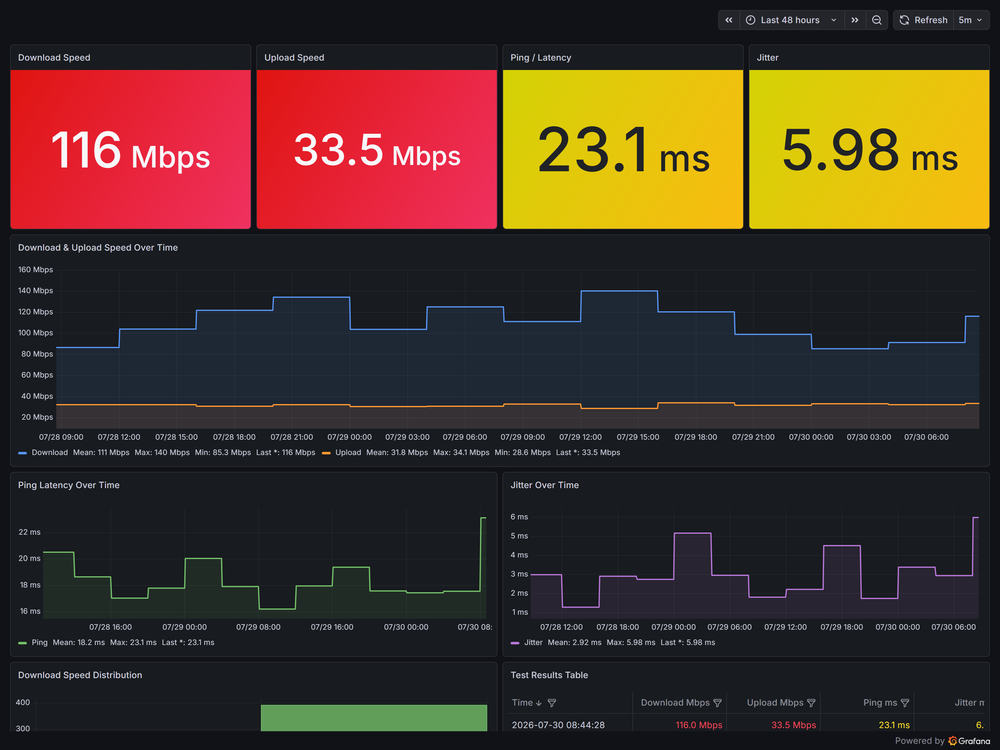
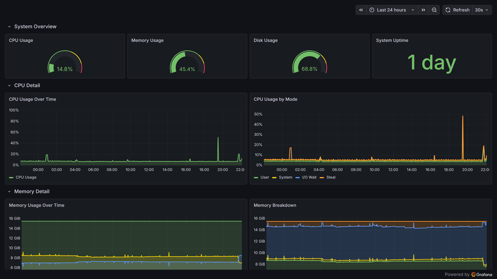
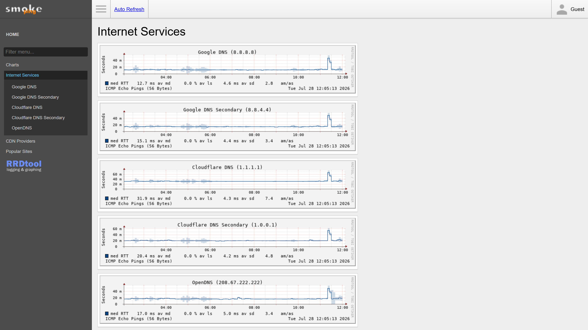

# ISP Monitor

[](https://github.com/scaso01/isp-monitor/actions/workflows/ci.yml)
[](LICENSE)

Your ISP promises a gigabit. This tells you what you actually got, every hour of
every day, with a year of receipts.

A self-hosted Docker Compose stack that runs Ookla speed tests on a schedule,
probes the wider internet for latency and packet loss, tracks the machine doing
the watching, and puts all of it behind Grafana. Seven containers, one
`docker compose up`, under 600 MB of RAM. Every dashboard, probe target and
alert rule is a file in this repo, so the stack comes up already configured. One
setting has to be switched on by hand afterwards, covered below.



## Why

Complaining to an ISP without data is a losing conversation. "It feels slow" gets
you a router reboot script read off a card. A chart showing your download speed
sitting at 40% of plan every weeknight between 8 and 11 PM gets you a truck roll.

This stack exists to produce that chart. Prometheus keeps 365 days of it, so the
evidence outlives the argument.

## What you get

- **Scheduled speed tests** — Ookla download, upload, ping and jitter on a cron
  you choose, stored and charted.
- **Latency and loss probes** — Blackbox Exporter hits six public endpoints over
  HTTPS and three DNS resolvers over ICMP, every 30 seconds.
- **Smoke graphs** — SmokePing's classic latency-distribution view over a dozen
  targets, the fastest way to see jitter that averages hide.
- **Alerting** — six Prometheus rules through Alertmanager, with email and Slack
  receivers a comment-uncomment away.
- **Host metrics** — CPU, memory, disk and network for the box doing the
  monitoring, so you can tell "my internet is slow" from "my server is busy".

## Quick start

```bash
git clone https://github.com/scaso01/isp-monitor.git
cd isp-monitor
cp .env.example .env
```

Generate the `APP_KEY` Speedtest Tracker needs and paste it into `.env`. It is
just 32 random bytes, base64 encoded, with a `base64:` prefix:

```bash
echo "base64:$(openssl rand -base64 32)"
```

No openssl on the machine? Docker is already a given here, so:

```bash
docker run --rm --entrypoint php lscr.io/linuxserver/speedtest-tracker:latest \
  /app/www/artisan key:generate --show
```

The `--entrypoint php` matters. This image runs s6-overlay as pid 1 and simply
passing `php artisan ...` as the command exits with
`s6-overlay-suexec: fatal: can only run as pid 1`.

Set `ADMIN_EMAIL`, `ADMIN_PASSWORD` and `GF_SECURITY_ADMIN_PASSWORD` in `.env`
while you are in there. The Speedtest Tracker pair is seeded by a first-run
migration, so it only takes effect if you set it *before* the first start —
otherwise you are left with `admin@example.com` / `password` and have to change
it in the UI. Then:

```bash
docker compose up -d
```

Give it two or three minutes to pull images and settle.

### Enable the Prometheus endpoint

**Do this or the speed dashboard stays empty.** Speedtest Tracker ships its
Prometheus exporter switched off, and the endpoint returns a 404 until you turn
it on — there is no environment variable for it, it is a stored setting.

1. Open <http://localhost:8082/admin> and log in with the `ADMIN_EMAIL` /
   `ADMIN_PASSWORD` you set above. Port 8082 on its own serves a Getting Started
   page with no login form on it, so go straight to `/admin`.
2. In the left sidebar, under **Settings**, click **Data Integration**.
3. That page opens on the **InfluxDB v2** tab. Switch to the **Prometheus** tab,
   turn on **Enable**, then **Save changes**. Both tabs have a toggle labelled
   the same thing, so check which one you are on before flipping it.

Prometheus picks it up on the next scrape. Confirm with:

```bash
curl -s http://localhost:8082/prometheus | head
```

You want `speedtest_tracker_download_bits{...}` in the output. `# no data
available` means the exporter is on but no speed test has finished yet — wait
for the first scheduled run, or trigger one from the Speedtest Tracker UI.

## Services

Several of these images default to popular ports (3000, 8080, 9090), so the
stack deliberately publishes them shifted to coexist with other Compose
projects. Each mapping is `host:container` — change the left number if it
collides on your machine, leave the right one alone.

| Service | URL | Mapping | Purpose |
|---------|-----|---------|---------|
| Speedtest Tracker | <http://localhost:8082> | `8082:80` | Ookla speed tests on a schedule |
| Grafana | <http://localhost:3003> | `3003:3000` | The three dashboards below |
| SmokePing | <http://localhost:8081> | `8081:80` | Latency distribution graphs |
| Prometheus | <http://localhost:9091> | `9091:9090` | Metric storage, 365-day retention |
| Alertmanager | <http://localhost:9093> | `9093:9093` | Alert routing and grouping |
| Blackbox Exporter | scraped internally | `9115:9115` | HTTP and ICMP probes |
| Node Exporter | scraped internally | `9100:9100` | Host CPU, RAM, disk, network |

## Dashboards

All three are provisioned from `grafana/dashboards/` on startup — nothing to
import by hand.

### ISP Speed Monitor

Download and upload against your plan, ping, jitter, a speed histogram, and a
table of recent runs. Note that Prometheus only records what it scrapes, so this
dashboard starts empty and fills in from the moment you install — Speedtest
Tracker's own UI is where the full result history lives.



The stat cards are coloured for a gigabit line, green above 800 Mbps down and 30
up. Down and up are not symmetrical because cable is not: a gigabit cable plan
typically uploads around 35 Mbps, so grading upload against the download figure
would fail every test forever. The run above is behind a VPN, which is why
download reads red at 116. Retune both `grafana/dashboards/isp-speed.json` and
`prometheus/alert.rules` to your own plan, they carry the same numbers.

Every query on this dashboard is wrapped in `max()`. Speedtest Tracker's exporter
stamps the Ookla server it used into `server_id`, `server_name`, `isp` and four
more labels, and Ookla hands you a different server most runs, so a bare
selector returns one series per server ever used. Left alone the legend grows a
fresh Download row per server, the stat cards get handed several series at once,
and the results table renders label columns instead of speeds. Aggregating drops
those labels at query time, which also fixes history already on disk.

### ISP Uptime & Latency

Probe success timeline, HTTP latency per target, DNS lookup time, TLS
certificate expiry, and the HTTP request phase breakdown — DNS, connect, TLS,
processing, transfer — which is how you tell a slow site from a slow line.


### Host System Metrics

CPU by mode, memory breakdown, disk usage and I/O, network throughput.



### SmokePing

Outside Grafana, SmokePing keeps its own RRD history and draws the smoke graphs
it is named for — the grey band is the spread of individual pings, so jitter
shows up as thickness rather than being averaged away.



## Alerts

| Alert | Condition | Severity |
|-------|-----------|----------|
| SlowDownloadSpeed | Download < 800 Mbps | Warning |
| SlowUploadSpeed | Upload < 30 Mbps | Warning |
| HighPacketLoss | Probe failing > 2 min | Critical |
| TargetDown | Scrape target unreachable > 5 min | Critical |
| HighLatency | Probe > 50 ms for 5 min | Warning |
| HighJitter | Probe stddev > 10 ms over 10 min | Warning |

**These defaults assume a gigabit fibre line on a direct connection.** On a
slower plan, or behind a VPN, the speed and latency rules will fire constantly
and you will start ignoring them. Edit `prometheus/alert.rules` to match your
plan, then reload without restarting:

```bash
curl -X POST http://localhost:9091/-/reload
```

Alerts land in the Alertmanager UI by default and go nowhere else.
`alertmanager/alertmanager.yml` carries commented-out email and Slack receivers
— uncomment one and fill it in.

## Tuning what gets probed

- `prometheus/pinghosts.yaml` — the HTTPS endpoints Blackbox probes.
- `prometheus/prometheus.yml` — the ICMP targets, and every scrape interval.
- `smokeping/config/Targets` — the SmokePing tree.
- `.env` — `SPEEDTEST_SCHEDULE` takes a cron expression; the default is every
  three hours. Ookla rate-limits aggressive schedules, and each test moves real
  data, so think before going below hourly.

## Resource usage

Measured with `docker stats` on a running instance carrying five months of
history:

| Service | RAM |
|---------|-----|
| Prometheus | 185 MB |
| Grafana | 181 MB |
| Speedtest Tracker | 111 MB |
| Blackbox Exporter | 28 MB |
| Node Exporter | 18 MB |
| Alertmanager | 15 MB |
| SmokePing | 13 MB |
| **Total** | **~551 MB** |

Every service carries a `mem_limit` in the Compose file. Prometheus grows with
retention, so a fresh install starts lighter than this.

Prometheus is set to 365-day retention. At these scrape intervals the same
instance reached 2.1 GB of TSDB after five months, so budget around 5 GB for a
full year.

## Management

```bash
docker compose logs -f speedtest-tracker   # follow one service
docker compose restart prometheus          # restart one service
docker compose down                        # stop, keep data
docker compose down -v                     # stop, delete all data
```

Configuration changes to Prometheus and Alertmanager do not need a restart:

```bash
curl -X POST http://localhost:9091/-/reload   # prometheus
curl -X POST http://localhost:9093/-/reload   # alertmanager
```

Grafana rescans `grafana/dashboards/` every 30 seconds, so edited dashboard JSON
applies on its own.

## License

MIT — see [LICENSE](LICENSE).
